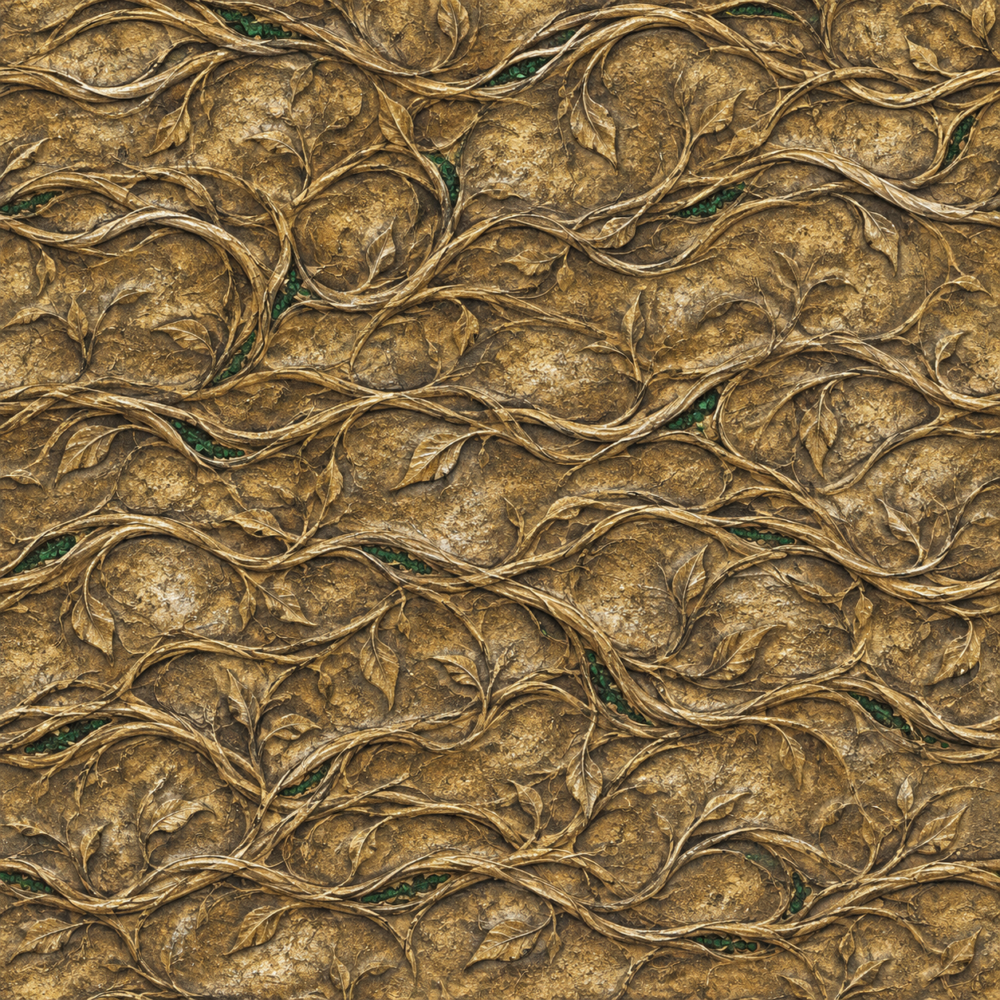

> Developed, integrated and packaged with **Codex**. The artwork draft was generated with the built-in imagegen tool.

<div align="center">



# Evergrowth Ring

**A ring that keeps growing with its wearer's kills.**

[简体中文](README.md) · **English** · [Download PAK](EvergrowthRing.pak) · [Detailed Chinese manual](README.zh-CN.md)

Windows · Baldur’s Gate 3 · BG3 Script Extender ≥ 34 · Version 0.3.0

</div>

**Experimental build: not tested on Windows or inside BG3.** The repository includes an importable `.pak`, 59 passing rule/mock-adapter/archive tests and online Stats/RootTemplate format-validation records. These do not establish actual combat, save/load, resource recalculation, UI rendering or multiplayer compatibility. API audit date: 2026-11-03.

## Contents

- [Installation](#installation)
- [Progression and bonuses](#progression-and-bonuses)
- [Live panel and upgrade effect](#live-panel-and-upgrade-effect)
- [Artwork](#artwork)
- [Compatibility and saves](#compatibility-and-saves)
- [Development](#development)

## Installation

1. Back up a test save and exit the game. Install [Norbyte BG3 Script Extender](https://github.com/Norbyte/bg3se/releases), using its official updater for a build compatible with your game. The running extender must be version 34 or newer.
2. Download [EvergrowthRing.pak](EvergrowthRing.pak) using **Download raw file** on its GitHub file page. Import it into [BG3 Mod Manager](https://github.com/LaughingLeader/BG3ModManager), activate **Evergrowth Ring**, save and **Export Order to Game**.
3. Load a test save. The server requests one new level-0 ring for the host character, once per save timeline. Equip it and use **Inspect Evergrowth Ring** to open the panel.

Installation requires no Python, MCM, Community Library or additional Mod Fixer. When upgrading, exit the game, replace the previous package and export the load order again. Never activate two packages with the same module UUID. Instance progression is retained by the migration logic; migration has only been tested with mocks.

For manual placement, use `%LOCALAPPDATA%\Larian Studios\Baldur's Gate 3\Mods\EvergrowthRing.pak`, then activate/export the order. Server console commands include `!er_status`, `!er_panel`, `!er_give`, `!er_addhp 4600`, `!er_repair` and `!er_cleanup`. The XP command changes save data and is intended for testing.

## Progression and bonuses

Each ring starts at `n = 0`, with no configured level cap. A qualifying kill by its wearer grants the victim's **maximum HP at the death event / 100**, excluding temporary HP. Current HP is normally zero on death and is not used. Summoned victims are excluded using the engine's summon classification.

Advancing from `n` to `n+1` costs `10 + 5n` progress. Overflow is retained and may advance several levels at once: 46 progress takes a fresh ring to **level 3 with 1/25 progress**.

| Direct bonus per ring | Amount |
| --- | --- |
| All six abilities, spell DC, six saves, AC, attack rolls, general damage | `+n` each |
| Every skill check | `+n` |
| Initiative | `+floor(n/4)` |
| Movement per turn | `+n` metres |
| Critical threshold reduction | `floor(n/10)` |
| Full actions / bonus actions per turn | `+floor(n/10)` / `+floor(n/8)` |
| Maximum ordinary spell slots, levels 1–6 | `+n` per level; grants no spells or casting ability |
| Existing pact-slot level's maximum | `+n`; grants no new pact casting |
| Attack damage riders | `n` of each of the 13 damage types |

Ability modifiers may produce further normal engine benefits beyond these direct bonuses. The typed attack riders use native `IsAttack()` / `DamageBonus`, including weapon, unarmed and spell attacks with attack context. Pure save spells and surfaces do not receive these 13 attack riders. There is no damage callback that applies more damage, avoiding this mod's own recursive damage chain. Rays, DRS and other equipment procs still require in-game verification for each setup.

Progression belongs to the **item instance**, surviving unequipping, transfer and storage while that instance exists. A new item starts at level 0. Two rings add linear bonuses; floor-based bonuses are calculated per ring before summing. Kill progress is divided equally between the wearer's equipped rings. It is not duplicated.

## Live panel and upgrade effect

The inspect action opens a persistent standalone panel showing each known loaded ring's level, progress, next-level requirement, remaining progress, progress bar and direct bonuses. You can switch instances. Read-only server snapshots refresh after progression and equipment changes, with polling while the panel is open. The native inventory tooltip remains static.

Actual ring upgrades request the original `VFX_UI_LevelUp_01` effect on the wearer, once per settlement even for several levels or two upgrading rings. This does not award character XP or trigger a class level-up. **The panel and effect have not been rendered inside the game.** See [UI details](docs/UI_PANEL.md).

## Artwork

The [PNG base-color draft](artwork/evergrowth-gold-vines-basecolor-draft.png) uses aged gold, engraved roots/vines and emerald life-energy seams. It is original generated artwork inspired by fantasy jewellery, not an extracted game texture.

**It is not integrated into the `.pak`.** The installed ring currently inherits the vanilla `LOOT_GEN_Ring_A_Simple_Gold` model/material/icon. The draft is not UV-matched or a complete calibrated PBR set; no normal/roughness maps, DDS conversion or seamless-tiling verification are claimed. See [artwork status and generation prompt](artwork/README.md).

## Compatibility and saves

- Instance progression uses persistent server-side SE UserVars. Clients only receive read-only panel snapshots. Multiplayer is untested; all participants should use the same package and compatible SE.
- Equipping/upgrading is designed not to refill spent slots or current-turn actions/movement. New slot capacity awaits the appropriate rest; new turn resources await the next turn. Actual engine recalculation timing remains untested.
- Deaths without a valid engine kill attribution may not grant progress. Unmarked custom summons cannot be identified universally. Mods that destroy and recreate items may produce a new instance and lose the old ring's progression.
- No configured cap does not mean infinite numeric capacity: Lua precision, native integer fields and engine/UI limits still apply. Out-of-range boost rebuilds are rejected with a warning while progression is retained.
- Before uninstalling, back up, unequip all rings and run `!er_cleanup` with all relevant characters loaded; wait about one second, save to a new slot, exit, then disable the mod. Keep a pre-installation save. Cleanup cannot reach unloaded characters.

## Development

Python 3.10+ builds the package offline, without pip dependencies:

```shell
python tools/build.py
```

Windows users can also run `Build-Windows.cmd`. To run rule, mock-engine/client and archive tests:

```shell
python -m pip install -r requirements-dev.txt
python -m pytest -q tests
```

- [Detailed installation and in-game acceptance checklist, Chinese](README.zh-CN.md)
- [API and data-format audit](docs/API_AUDIT.md)
- [Validation record and untested scope](docs/VALIDATION.md)
- [Changelog](docs/CHANGELOG.md) / [Package checksums](BUILD_MANIFEST.json)
- [MIT license](LICENSE.txt) / [Third-party notices](THIRD_PARTY_NOTICES.md)

Unofficial fan mod, unaffiliated with Larian Studios or Wizards of the Coast.
