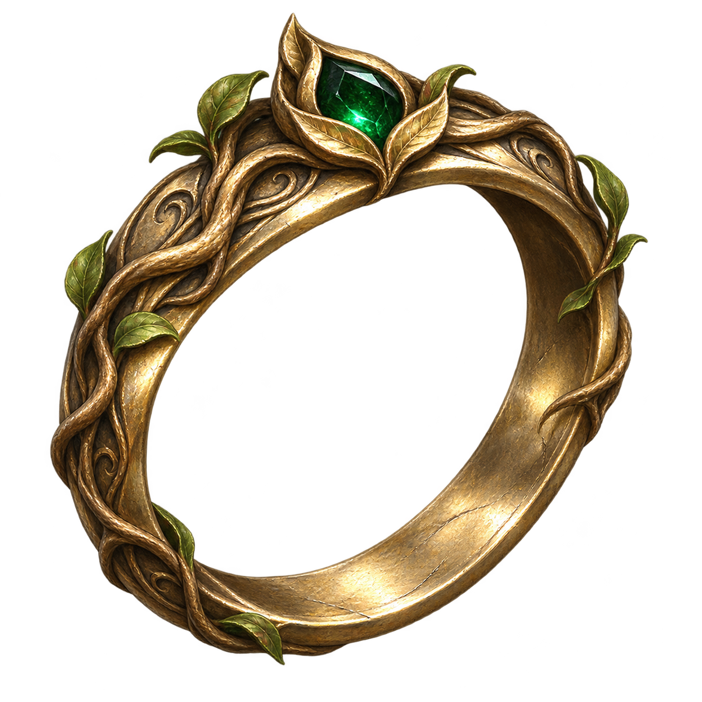

# 戒指图标 / Ring icon



本图由**内置 imagegen / generate 模式**生成，日期2026-11-03；源文件为 `evergrowth-ring-icon.png`，1254×1254，带真实透明通道。它呈现完整的金色藤蔓戒圈、中心空洞和翠绿宝石，作为项目封面与2D物品图标。它不是3D模型或材质平铺纹样。

实际生成提示词：[ring-icon-prompt.txt](ring-icon-prompt.txt)。保留的纹样稿仍见[材质说明](README.md)。

## 游戏接入

- 根模板 `Icon = ER_Item_EvergrowthRing`，不覆盖任何原版图标。
- 64×64 BC3/DXT5单格图集：`Public/EvergrowthRing/Assets/Textures/Icons/ER_Icons_Evergrowth.dds`。
- UV图集文件：`Public/EvergrowthRing/GUI/ER_Icons_Evergrowth.lsx`。此文件必须以LSX进包，不能与作者源XML一起排除。
- TextureBank以LSF保存于 `Public/EvergrowthRing/Content/UI/EvergrowthRing_UI/_merged.lsf`，图集UUID为 `5a202739-7df4-47a8-a2be-90888f45cf84`。
- 144×144手柄图：`Mods/EvergrowthRing/GUI/Assets/ControllerUIIcons/items_png/ER_Item_EvergrowthRing.DDS`。
- 380×380悬浮说明图：`Mods/EvergrowthRing/GUI/Assets/Tooltips/ItemIcons/ER_Item_EvergrowthRing.DDS`。
- `metadata.lsf`登记对应`.png`逻辑键、实际尺寸与`mipcount=1`；物理文件为DDS。AssetsLowRes提供同尺寸兼容副本，未声称已做低内存优化。所有DDS无mipmap链，保留BC3透明通道。

检查了64px压缩回读预览：[查看](icons/64/ER_Item_EvergrowthRing-bc3-preview.png)。构建检查和测试覆盖图标引用链、UV覆盖、元数据深度/尺寸、DDS头/长度、边角/中心透明、非空戒圈与PAK包含关系。**没有在Windows、Toolkit或游戏里渲染过**；检查通过不证明原生UI查找一定成功，仍需实机验收背包、装备槽、手柄和悬浮说明。

## 重新导出

普通Mod构建直接使用已提交的DDS，只需要Python，不要求Node或npm。仅重新导出美术资源时，需要Node.js（满足sharp依赖版本要求）及以下可选工具：

```shell
npm install --prefix tools/icon-deps
node tools/build_icons.cjs
python tools/build.py
```

导出脚本只做尺寸适配、sRGB编码与BC3压缩，绘制内容来自imagegen；PNG预览保存在`artwork/icons/64`、`144`、`380`。脚本要求背景和中心仍透明，不会给图标填充黑色底板。源PNG保持不变。

参考官方[图标接入指南](https://docs.baldursgate3.game/Adding_Skill_and_Item_Icons)，DDS格式按[微软DDS说明](https://learn.microsoft.com/en-us/windows/win32/direct3ddds/dx-graphics-dds-pguide)编写；具体资源结构还核对了[图标工具作者的实现](https://github.com/Atamg1994/Bg3_Icon_bulder/blob/8681d7ea0a6b1058fd6a06043a46c5ddb0baf017/app.js)。
