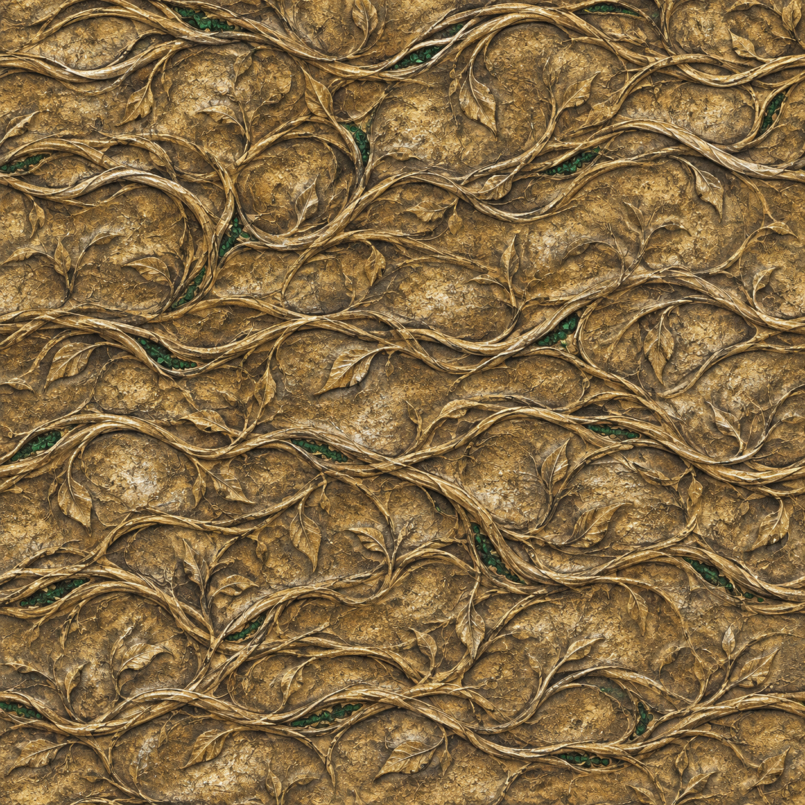

# 无尽生长之戒：材质底色绘制稿



文件：`evergrowth-gold-vines-basecolor-draft.png`，1254 × 1254 PNG。使用 **内置 imagegen / generate 模式**生成，日期 2026-11-03。主题为旧金与浅色合金、藤蔓根系雕纹、翠绿生命结晶，以表现戒指汲取生命并持续成长的设定。画面是金属表面的绘制稿，不是戒指模型、游戏截图或背包图标。

## 接入状态

- 美术源已随仓库提供；**当前 `.pak` 不包含此图片，游戏仍使用原版金戒指材质**。
- 尚无所用原版模型的 UV 展开，不能把这张方图直接声明为贴合该模型的成品。
- 生成提示要求平光和可拼接，但图中仍有装饰浮雕和明暗；未完成边界拼接检查、颜色校准或 PBR 去光照。不能把生成要求当成已通过的验收。
- 未制作法线、粗糙度、金属度等配套图，也未转换为引擎纹理资源。后续需要取得合法可用的模型 UV，针对它绘制/烘焙并建立 BG3 材质及资源引用，重新打包后实测。
- 原创生成图，无官方纹理抽取或品牌标志。项目采用 MIT；第三方和原版游戏资源另见[第三方声明](../THIRD_PARTY_NOTICES.md)。

SHA-256：`c39c84f7babadc2adc229df7032e2365832dbbfa94a2feba273e46c5287556f3`

## 最终生成提示词

以下保留实际提交的提示词；其中 1024 × 1024 是请求尺寸，实际返回 PNG 为 1254 × 1254。

```text
Use case: stylized-concept. Asset type: actual flat 2D base-color/albedo texture authoring source for the metal band of a Baldur's Gate 3 fantasy ring mod named Evergrowth Ring. This is a SURFACE TEXTURE, not a picture of a ring, not a product render, and not an icon. Create one square 1024x1024 high-resolution tile intended to repeat seamlessly. It should feel like the meticulously crafted, weathered, dark high-fantasy magic jewellery found in Faerun: aged pale gold/electrum metal, restrained silver highlights inherent in the metal color, oxidized dark recesses, exquisite thin engraved intertwining roots and climbing vines that suggest an artefact absorbing life and growing stronger. Tiny dark emerald crystalline seams within selected engravings suggest stored life essence; mostly readable aged gold metal, never a green wall. The underlying object is a small ring band so details must be clean and fine, not large motifs. Flat orthographic macro surface view filling the entire canvas edge to edge; evenly lit neutral diffuse color, no perspective, no baked directional lighting, no cast shadows, no specular bloom, no vignette, no text, no readable runic lettering, no logo, no borders, no ring silhouette, no objects. The pattern must continue naturally across all four tile boundaries. Original artwork inspired by the game's material aesthetic; no copied game texture or official branding.
```
